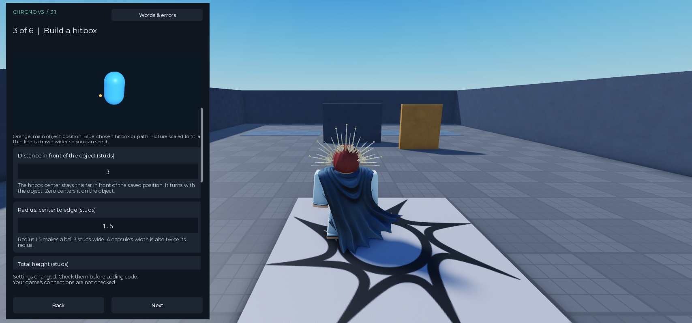

<p align="center"></p>

<p align="center"></p>

<p align="center"><strong>Your movement. Your moves. Checked contact evidence.</strong><br>
<a href="https://vertimaxx.github.io/ChronoFork-V3.1/">Documentation website</a> · <a href="docs/start-here.md">Start here</a> · <a href="docs/comparison.md">Original vs fork</a> · <a href="docs/benchmarks.md">Benchmarks</a> · <a href="CREDITS.md">Credits</a></p>

# ChronoFork V3.1

**Check whether a move's hitbox touched an allowed object, using positions your server calculates or checks.** Built for game-owned tackles, ball contacts, melee moves, rays and swept spheres. Your game decides what the contact means: possession, damage, stun, a block or something else.

**This is an unofficial Chrono fork. Original credit belongs to [Parihsz and the Chrono contributors](https://github.com/Parihsz/Chrono). The competitive branch, tools, tests and documentation were developed with OpenAI Codex / AI, under VertimaXx's direction.** The upstream MIT notice is preserved. See [credits and lineage](CREDITS.md).

V3.1 is a standalone contact-validation branch of that work. It does not bundle original Chrono's physics-replication framework and does not replace `Chrono.Start()`. You can keep an existing replication system and supply checked server data through small connecting functions.

## What you get

- **Five query shapes:** box, sphere, capsule, ray and swept sphere. Target hitboxes can be boxes, spheres or capsules.
- **Checked earlier positions:** refuses missing, too-old or uncertain records instead of silently substituting an endpoint. A reset separates data before and after a teleport or respawn.
- **Game-owned connections:** movement, animations, VFX, cutscenes, camera and outcomes remain in your game.
- **Studio connection workflow:** six setup pages, hitbox preview, automatic tracking/recording, existing server-event links and a builder for reviewed calls in existing scripts. Changes have Undo/Redo and source-aware restore.
- **Position-source choices:** server-owned physics, a supplied limited humanoid checker, or your existing checker with mapping functions inside the package.
- **Beginner-friendly help:** 50 explained terms, 48 base result messages, examples and optional in-game developer guides. Decimal comma and decimal point inputs are supported.
- **Practice before integration:** a test using made-up server values starts disabled. It helps you learn; it does not certify your game.



*Real V3.1 setup view from the development lab. The background arena is not shipped with this repository.*

## Install from scratch

1. Download [ChronoV3Setup.rbxmx](dist/ChronoV3Setup.rbxmx) using GitHub's **Download raw file** button, or download the [complete V3.1 bundle](dist/ChronoFork-3.1.0.zip) and extract it.
2. In Studio's Explorer, right-click **ServerStorage → Insert from File** and select the setup file. Right-click the inserted **ChronoV3Setup** Script → **Save as Local Plugin**. Save it as **Chrono V3**, then remove the imported source Script from your place.
3. Use **Plugins → Chrono V3 → ChronoSetup**. Complete the setup, review the generated code, then add it. **This is the plugin integration step.**
4. On **Connect your game**, select objects and a position source, add the supplied connection package, then link existing server events or use **Calls** to generate and insert the small calls your game needs. Customize supplied Hooks for unusual rules.
5. Press Play and inspect the connection guide/report. Test the actual game with multiple clients and Studio's Network Simulator. For a first success with no scripting, **Try a complete supplied learning scene** on page 1.

The [connection walkthrough](docs/connections.md) explains the V3.1 connection build dated 24 October 2026. [Start here](docs/start-here.md) also documents the advanced low-level API. Prefer code-only installation? Import [ChronoV3.rbxmx](dist/ChronoV3.rbxmx) as a ModuleScript, or map `src/` with the included [Rojo project](default.project.json).

| Download | Purpose |
|---|---|
| [Setup plugin](dist/ChronoV3Setup.rbxmx) | Guided setup and source generator |
| [Core module](dist/ChronoV3.rbxmx) | Library without the plugin |
| [Toolkit](dist/ChronoV3Toolkit.rbxmx) | Core, setup source and V3.1 examples together |
| [Developer guide](dist/ChronoV3Guides.rbxmx) | Optional in-game instructions; restrict access to your developers |
| [Tests](dist/ChronoV3Tests.rbxmx) | Import into a separate Studio place |
| [Complete ZIP](dist/ChronoFork-3.1.0.zip) | Source, assets, documentation and recorded results |

The toolbar and ModuleScript names remain `Chrono V3` / `ChronoV3` for compatibility; their version is **3.1.0**.

## How your game connects

```text
Your server's checked positions → Track + Capture → short position record
Your server accepts a move      → BeginAction     → Query during hit period
Covered contacts               → your current rules → apply a result once
Move ends or is cancelled      → EndAction
```

**Server decides** means the server calculates a value or checks that it was allowed. Developers often call this *authoritative*. Reading a client-controlled part on the server does not establish that its movement was allowed.

The plugin's optional **Connector** supplies object tracking, shared recording, move references and cancellation. You select existing objects/events or insert the generated calls at your existing accepted-move and outcome points. Unusual mappings belong in the supplied Hooks. The low-level lifecycle remains `Track → Capture → BeginAction → Query → EndAction`. Connector starts its own recording loop after you install it; no gameplay remote is added. See [the connection walkthrough](docs/connections.md) or [the exact API](docs/integration.md).

**A tested existing-game example:** one melee game's connection required three plugin-generated call blocks in one original script. Its movement rules were mapped inside supplied Hooks; six other original scripts stayed byte-identical. All 80 recorded integration checks passed. This was active contact rejection, with rewind off. [Follow the exact developer steps and inspect the evidence](docs/combat-walkthrough.md).

## Compared with original Chrono

| Question | Original Chrono | ChronoFork V3.1 |
|---|---|---|
| Main job | Physics replication and smooth presentation | Checked gameplay contact evidence |
| Basic setup | `Chrono.Start()` for replication | Plugin or module, then explicit game connections |
| Earlier-time result | Transform snapshot API; caller must check evidence policy | Strict coverage, age, gap, reset and state checks |
| Character movement / animation validation | Game-specific work | Still game-specific work |
| Complete anti-cheat / finished combat system | No | No |

In the **earlier V3.0 matched history benchmark**, 34,000 covered queries used the same two endpoints and randomized endpoint velocities. Original Chrono overshot the scalar endpoint range 5,958 times; the fork's linear positions did so zero times. The test deliberately imposed a straight-line reference that the velocities could contradict. This demonstrates interpolation behavior, **not a universal hit-registration accuracy improvement**.

Checked query time in that run averaged **1.540 µs vs 0.577 µs** for original Chrono, about **2.67× the CPU time**. The fork also interpolated a zone and checked state; original returned a transform. No FPS or bandwidth advantage is claimed. [Read the methods, tradeoffs and full comparison](docs/comparison.md).

## Recorded validation

| Evidence | Result | When / meaning |
|---|---:|---|
| V3.1 unit tests | 63 / 63 passed | Includes randomized math groups; not 63 independent game trials |
| V3.1 timeline scenarios | 8,192 / 8,192 passed | Seeded synthetic timing; RTT policy inputs 0–1,000 ms |
| V3.1 practice variants | 15 / 15 passed | Three presets × five query shapes |
| V3.1 generated source | 90 files compiled | Six generated files per variant |
| V3.1 real installer checks | 8 / 8 passed | Including Undo, Redo, rollback and conflict preservation |
| V3.1 connection workflow, 24 Oct | 39 edit + 165 runtime + 63 core checks passed | Supplied connections, generated calls, real client and learning scene |
| V3.1 existing combat integration, 24 Oct | 80 / 80 passed; 27 installed sources compiled | 59 baseline comparisons, 8 client inputs, 9 gate checks, 4 movement flows; one client, zero added delay |
| Earlier V3.0 engine geometry oracle | 6,000 / 6,000 passed | Roblox overlap/cast comparisons; sweep tolerance 0.025 studs |
| Earlier V3.0 matched history | 34,000 shared covered queries | Pinned original source and deliberately linear reference |

The five numerical/history modules were unchanged between the measured V3.0 build and V3.1. **Earlier timing and engine-oracle results remain earlier measurements.** Tests were performed on one Studio workstation. V3.1 has not been certified in a real competitive game, and the synthetic suite is not actual packet-loss or network-emulation testing. [Raw JSON, workload details and reproduction](docs/benchmarks.md).

## Know the limits before choosing it

Use positions the server calculates or genuinely checks. The supplied humanoid option adds bounded root checks for ordinary static-ground movement; it does not solve all movement security. Your game still validates input, cooldowns, stamina and ownership and owns its outcomes. The supplied connector performs one hit check per move. Sampled hitboxes do not reconstruct every path between updates. Exact animated limbs, lag policy and historical obstacles need game-specific providers. Strict uncertainty can refuse an action; joins/removals invalidate active actions globally. Matching actors and zones are scanned, so profile real workloads.

Read the [ranked limitations and math](docs/math-and-limits.md). A successful query with zero contacts is a checked miss. A refused query means evidence was insufficient; it is a separate result.

## Documentation

- [Start here](docs/start-here.md) — installation and first success
- [Plugin connections](docs/connections.md) — supplied runtime, movement options, event links, generated calls and restore
- [Existing combat walkthrough](docs/combat-walkthrough.md) — exact plugin steps, three generated calls and in-package movement mapping
- [Connect your game](docs/game-integration.md) — sports, melee and ray examples; responsibilities
- [Exact API](docs/integration.md) — functions, values and bounds
- [Math and limitations](docs/math-and-limits.md) — calculations and ranked tradeoffs
- [Comparisons](docs/comparison.md) — original Chrono and historical comparison-only appendix
- [Benchmarks](docs/benchmarks.md) — methods, raw results and reproduction
- [FAQ](docs/faq.md) · [Credits](CREDITS.md) · [Contributing](CONTRIBUTING.md)

## Build from source

Python 3.10+ is enough to rebuild the assets, website and ZIP. No external Python packages are required.

```sh
python tools/build.py
python tools/check.py
```

These commands check packaging and documentation, not Roblox runtime behavior. The Studio tests and optional Luau compilation are described in [benchmarks](docs/benchmarks.md). This repository ships **V3.1 code only**. Earlier V1/V2 work appears solely as historical comparison evidence.

MIT licensed. Original copyright retained. [Parihsz/Chrono](https://github.com/Parihsz/Chrono) is the upstream project; this fork is independently maintained and is not an official upstream release.
