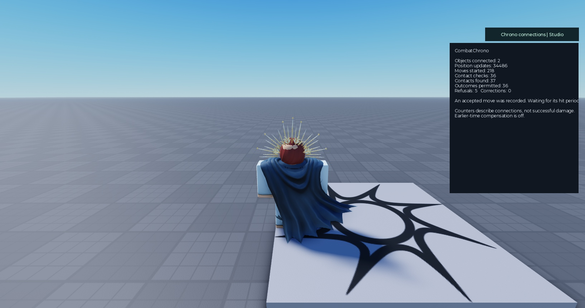

# A real combat connection, step by step

This historical example records the **24 October 2026 V3.1 build** connecting an existing R6 melee game. Current Connector/plugin is 3.2 with unchanged Core 3.1; use [current connections](connections.md) and [full controls](connector-controls.md) for new work. The example retained damage, controls, animations, combo, blocking, cancellation and knockback code, while actively refusing contacts when checks failed. Its 80 results do not test newly enabled 3.2 policies in that game.

**The external changes were three plugin-generated calls in one existing script.** Game-specific movement mapping was written inside the supplied **Hooks** file. Minimal external work does not mean every game connects without understanding its own rules.

The plugin's exact setup, installation, connection and call-builder operations were executed through Studio MCP because native window capture was unavailable. Real Studio editing and Undo services were used. This is evidence for those operations; it is not a claim that the toolbar wizard was clicked by a human.

## What was already in the game

- The server checked the player's request and attack cooldown.
- The original attack waited 0.25 seconds and could be cancelled during that wait.
- A server function then made an 8 × 8 × 6 box, four studs in front of the character, and used Roblox's current-part overlap query.
- The original damage handler already handled blocking, immunity, seven damage per hit and a four-hit combo.
- The game already created movement tags, server knockback forces and a finisher ragdoll impulse.

These existing systems were prerequisites and connection points. No replacement combat system, separate adapter module or external movement system was added. Six of seven original scripts remained byte-identical. The seventh differed only by the three generated call blocks.

## 1. Describe the existing move in ChronoSetup

Choose the melee example, then use these values for this particular game:

| Setting | Value | Why |
|---|---|---|
| Added code name | CombatChrono | The installed package's name |
| Object kind / target kinds | fighter / fighter | A matching group name for these characters |
| Shape | Box | Matches the existing attack |
| Width / height / depth | 8 / 8 / 6 studs | Matches the original box |
| Forward distance | 4 studs | Matches its original placement |
| Opens / closes | 0 / 0.1 seconds | Begin runs after the game's existing windup |
| Maximum targets | 256 | The original loop can check multiple targets |
| Saved-position retention | 0.6 seconds | Short records for the checker |
| Maximum record gap | 0.1 seconds | Refuse evidence that has stopped updating |
| Rewind | 0 | Check the present; no new lag compensation |
| Maximum movement receipt speed | 4096 | Broad record sanity bound, not legal walking speed |
| Maximum body extent | 16 studs | Allows the deliberate target envelope below |

Use the matching-kind rule. The original handler keeps its block and immunity decisions. Review the generated setup and add it.

The move timing deserves care: Begin is placed **after** the existing cancellation and windup. This connection describes the final contact check. It does not independently verify that the game's original timer was implemented correctly. A game that starts Chrono before its windup instead needs matching action timing and cancellation calls.

## 2. Choose the objects and position checks in ChronoConnect

Select the installed **CombatChrono** group, then configure:

| Setting | Value |
|---|---|
| Object source | Folder: Workspace.Characters |
| Root Part | HumanoidRootPart |
| Object kind | fighter |
| Position option | Supplied humanoid checks |
| Walking / jump launch speeds | 20 / 50 |
| Root ground height | 3 studs |
| Burst window / horizontal slack | 0.4 seconds / 1.25 studs |
| Vertical slack / wall radius | 3 / 0.7 studs |
| Position correction | Off; refuse invalid contacts |
| Target body | Sphere, radius 12 studs |
| Automatic query | Off |
| Existing event links | None |
| Studio connection guide | Included |

**Correction off is still active checking.** An invalid move can refuse a hit without moving the character back. It is not observation mode.

The target sphere is a broad admission envelope around these R6 roots. The original native part-overlap query is still required, so the sphere does not enlarge the actual attack box. This combination preserves the game's existing contact behavior; it is not trusted reconstruction of animated limbs. Custom or larger rigs need deliberate configuration.

Review and add the connections. The supplied package starts tracking and recording automatically. No new gameplay RemoteEvent is installed. Its practice runner remains disabled.

## 3. Insert three calls using the Calls page

Select the existing server **HitDetection** script. Use actor `character`, action `Contact` and move variable `chronoMove`. The following are the bodies generated by the builder; the plugin also adds Restore markers.

Generate **Begin**, and insert it after the original argument checks but before the original hitbox Part is created:

```luau
local chronoMove = require(game:GetService("ServerScriptService")["CombatChrono"].Connector).Begin(character, "Contact")
if not chronoMove then return end
```

Generate **Gate**, with target `humanoid.Parent` and refusal `continue`. Insert it immediately before the original per-target damage event, inside the target loop:

```luau
if not require(game:GetService("ServerScriptService")["CombatChrono"].Connector).Allows(chronoMove, humanoid.Parent) then continue end
```

Generate **Finish**, and insert it after the loop, before the original hitbox cleanup:

```luau
require(game:GetService("ServerScriptService")["CombatChrono"].Connector).Finish(chronoMove)
```

Preview and apply each insertion. The plugin saves the exact original and resulting script text for Restore. There is no fallback that applies native damage after a Chrono refusal. A cancelled windup never reaches Begin in this game's architecture, so it needs no extra cancellation call.

## 4. Map existing movement rules inside Hooks

The supplied checker cannot infer what a private game's tags or forces mean. Edit **CombatChrono.Hooks**, using the supplied `MovementLimits` connection point. The complete tested file is [CombatMovementHooks.luau](../examples/CombatMovementHooks.luau); copy it into the installed package's Hooks only for a game with these exact rules. It is not a universal preset.

This example maps existing Action, NoJump, Stun, Blocking and LightAttack tags to their existing walking/jumping limits. It gives previously legal replicated movement a bounded 0.35-second transition allowance. An already-started legitimate jump keeps its launch allowance until landing.

The game already creates knockback at 10 studs/second for 0.2 seconds and 30 studs/second for 0.65 seconds. The Hook grants the supplied checker's existing motion permission once for each observed server force. It creates no force itself. The original finisher also applies a 100-unit torso impulse. The Hook allows its possible speed change using **change in velocity = impulse ÷ mass**, adding the result conservatively to the existing knockback speed.

The first moving test found false movement refusals when that existing finisher impulse was omitted from the mapping. The final Hook includes it. Revisit this mapping whenever the game's speeds, rig mass, tags or moves change. Do not copy permission values from client claims.

## 5. Test actual combat, then read the guide

Press Play and open **Chrono connections | Studio**. Check actual health and original outcomes alongside Chrono's counters. A setup success or an increasing counter alone does not prove that gameplay works.

| Recorded checks | Passed | What was compared |
|---|---:|---|
| Original-versus-connected behavior | 59 / 59 | Hits, misses, blocking, immunity, finisher, multiple targets, CanQuery and 48 seeded positions/orientations |
| Real-client original combat inputs | 8 / 8 | Punch, miss, block, force field, cancellation, cooldown, held block and four-hit combo |
| Accepted/refused move behavior | 9 / 9 | Start, target approval, duplicate, finished/cancelled/expired move, reset of cached contact, unknown move and invalid movement |
| Real moving-client flows | 4 / 4 | Walking/jumping, slight knockback, stun during a legitimate jump and finisher ragdoll |

**80 / 80 checks passed.** The final four movement flows recorded zero false movement refusals. Runtime adapter errors and Core provider faults were zero. All 27 final installed source files compiled. The four-hit combo still dealt 28 damage. The optional in-game guide opened and its measured text fitted.



Actual Play-client guide from the completed connection. It reports the supplied connection's status; individual result counters are not a replacement for the case data below.

[Recorded cases, measurements and provenance](../benchmarks/data/v3.1-combat-integration-2026-10-24.json) are separate from the original-Chrono numerical comparison. [Fixture-dependent test drivers](../benchmarks/harness/combat-20261024/README.md) are included for inspection and reproduction in a disposable copy of the original game. The underlying third-party combat place and its original source are not redistributed here.

These results use **one real Studio client**, with all six network impairment settings at zero. They are not a latency benchmark, multi-client certification or proof about arbitrary combat games. The eight Core modules, Connector and supplied Movement module were unchanged. Only the supplied Hooks file was customized.

## What a developer still needs to understand

The plugin supplies the connection machinery, generated calls, review, Restore and diagnostics. The developer identifies the accepted move and outcome points, uses the game's real dimensions/timing, and maps unusual rules inside Hooks. For this game, no extra framework outside the package was necessary.

The result still has no rewind, historical obstacles, full movement simulation or exact trusted limb animation. Vehicles, moving platforms, flight, teleports, new impulses or new attack phases require genuine game support. Test these in your own game with multiple clients and asymmetric network delay before shipping.

To remove the integration, use source Restore in reverse insertion order. Preserve customized Hooks before removing the connection package; removal deliberately refuses to discard modified supplied code.

Original Chrono: Parihsz and contributors. ChronoFork and this connection: OpenAI Codex / AI under VertimaXx's direction. The tested combat source's original author and ragdoll credits were retained in the local place.
