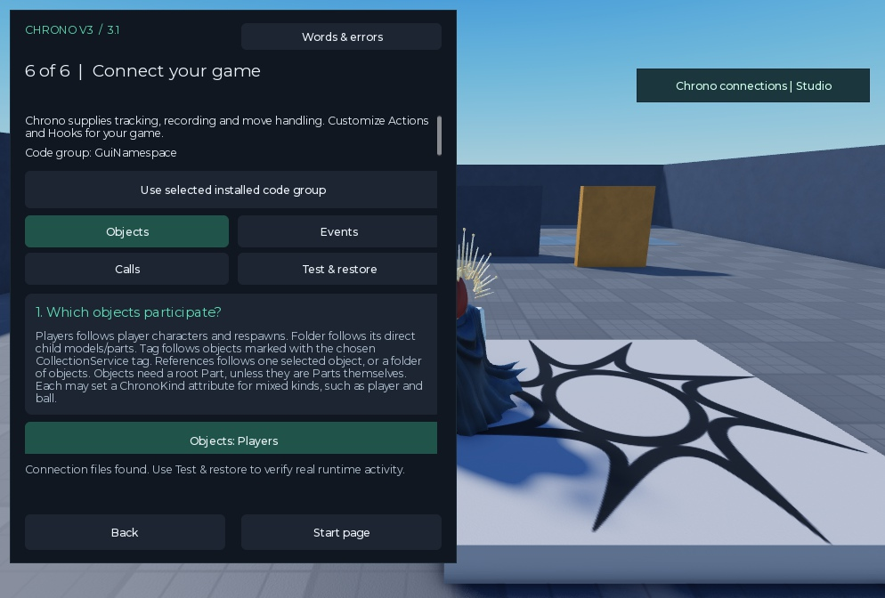
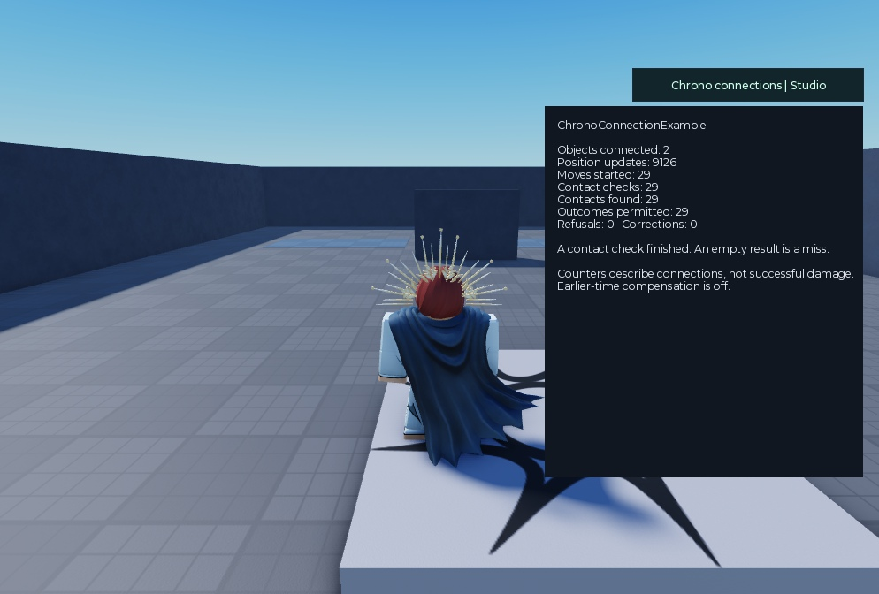

# Connect your game through the plugin

The V3.1 connection build dated **24 October 2026** supplies the routine connecting code. You choose where your game's objects and accepted moves come from. The supplied package handles registration, position recording, move references, cancellation and contact checks. The contact math is unchanged.

For a complete existing-game example, follow the [tested combat walkthrough](combat-walkthrough.md): three generated call blocks outside the package, game-specific mapping inside supplied Hooks, and 80 recorded passing checks. The developer still chooses connection points and supplies the game's actual rules.



The actual connection View rendered in PlayerGui for Studio viewport review. Native DockWidget screenshots were unavailable; this image does not claim native toolbar operation.

## First success with no scripting

Open **Plugins → Chrono V3 → ChronoSetup → Try a complete supplied learning scene**. Press Play. Two anchored example objects use the supplied server events to start a move, check contact and increase a practice counter. Click the **Chrono connections | Studio** guide to see the real counters. This scene does not change health or your combat system and does not certify your own game. Stop Play. Remove it using **Connect your game → Test & restore → Remove the supplied learning scene**.

## Connect an existing game

1. Use the first five setup pages to describe the attack and add its Core/Actions group. Match your existing hitbox dimensions and timing. Keep earlier-time compensation off initially.
2. Open **ChronoConnect**, or page 6. Choose your installed code group. Use **Objects** to select player characters, **Players + extra objects**, a Workspace folder, tagged objects or one selected reference. Choose the root Part name and default object kind. Models can also use their PrimaryPart when the named root is absent. Individual objects may use a server-set `ChronoKind` attribute, for example `player` or `ball`.
3. Choose how positions are checked. See the choices below. Choose the target's deliberate gameplay shape; it is separate from the attacking shape in Actions. Do not claim it reconstructs animated limbs.
4. If your game already has server BindableEvents, select them under **Events**. Otherwise use **Calls** to generate the small calls for your existing functions. Events and calls can be combined deliberately, but do not start/check/apply the same move twice.
5. Choose **Objects → Check connections and show changes → Add these reviewed connections**. This adds the runtime and enabled server startup. It adds no gameplay RemoteEvent and does not rewrite any existing script.
6. In **Calls**, choose Begin, Gate, Cancel, Finish, Motion or Teleport. Enter the variable names already used by your game. Select its existing server script, choose its line or read the editor cursor, and preview the edit. Apply the reviewed edit through the plugin. Each edit has its own Restore record. Teleport replaces the selected old teleport line; other calls insert before a selected line.
7. Press Play. Use **Test & restore → Read the running connection report**, or the optional Studio-only guide. Verify updates, accepted moves, checks and actual game outcomes separately. Test more than one client before shipping.

For later changes, **Load saved connection settings** and **Save connection settings** preserve customized Hooks and the runtime. Restart Play to load changes. Automatic guide installation is chosen on first install; its LocalScript can subsequently be disabled.

## The three position choices

| Choice | What the package provides | Your responsibility |
|---|---|---|
| Server calculates physics | Follows anchored/server-owned objects and records them automatically | The server must genuinely control those objects. Player-owned positions refuse checks. Server ownership does not prove every client-triggered game rule was legitimate. |
| Supplied humanoid checks | Bounded humanoid root-distance budget, jump/gravity checks and small wall sweeps; configurable refusal or position correction. Also accepts non-character objects with server-owned physics | Set actual allowed speeds and rig ground height. Connect legitimate knockback/teleports. Adapt existing slow/stun rules in Hooks.MovementLimits. Static ground only; vehicles, moving platforms, flight and unusual movement need additional support. Client-owned balls still need independent validation. |
| Existing position checker | Calls the selected server ModuleScript through Hooks.ProviderSnapshot | The existing system must actually calculate/check positions. Default API returns `{ok=true, root=CFrame, zones={...}, state={...}}`. Adapt another existing API **inside the supplied Hooks**. An `ok` field is a declaration by that checker, not independent proof. |

The humanoid option is a limited supplied movement policy, not complete anti-cheat. Initial-overlap wall cases, articulated bodies, animation, initial spawn authorization and movement within tolerances remain limitations. Source and target data still use the core's strict global uncertainty/roster policy. Large worlds, many actors and real replication bursts need game-specific profiling and testing.

## Existing events

Select **server BindableEvents**, after the game's input authentication and move checks. Raw RemoteEvents are refused by setup.

| Link | Default arguments |
|---|---|
| Begin | `sourceModel, actionName, moveKey, context` |
| Query | `sourceModel, moveKey` |
| Cancel | `sourceModel, moveKey` |
| Outcome | Receives `sourceModel, targetModel, actionName, context, contact` |

Action defaults to `Contact`. Use the same short key at start, hit and cancellation. An already-active key refuses another start. If your existing events use a different argument order, edit **Hooks.ReadBegin / ReadQuery / ReadCancel / ApplyOutcome** within the delivered package. Keep original block, parry, damage, possession and effect rules in the game's existing outcome handler.

Optional automatic timing checks once when the configured hit period opens. Use only if that matches the move; it needs an Outcome event and correct cancellation. Keep it off for precise existing hit moments, animation markers or target loops.

## Existing functions: the generated calls

The plugin generates these using your chosen names and code-group name. These examples assume `ChronoV3Integration`:

```luau
-- After existing server request/cooldown checks; before the original windup:
local chronoMove = require(game.ServerScriptService.ChronoV3Integration.Connector).Begin(character, "Contact")
if not chronoMove then return end

-- Immediately before an existing per-target damage/possession call:
if not require(game.ServerScriptService.ChronoV3Integration.Connector).Allows(chronoMove, target) then return end
-- The original outcome call remains here.

-- Existing cancellation path:
require(game.ServerScriptService.ChronoV3Integration.Connector).Cancel(chronoMove)

-- After the original hit loop completes:
require(game.ServerScriptService.ChronoV3Integration.Connector).Finish(chronoMove)
```

Inside a target loop choose `continue` instead of `return` in the Gate builder. The move reference must remain in the same scope across its start, hit and cancellation. If your architecture spreads these across services, store the reference in your existing server move record, or map existing events inside Hooks. The plugin cannot infer arbitrary variable scope or the meaning of private functions.

Allows performs one contact query on its first use and permits each approved target once. Cached results expire after maxGap and refuse after record resets/roster changes. This supplied connector deliberately handles **one hit check per move**; use separate accepted moves or the advanced core API for multiple hit phases. It has no native-damage fallback.

Motion grants the supplied humanoid checker permission for an **existing server-applied** velocity/duration; it does not create a force. Teleport **performs** an approved root teleport and resets records. Generated Teleport replaces the selected old statement; keep unrelated work on separate lines and inspect the preview.

## Customize inside the supplied package

- **Connections / ConnectionData:** the reader and saved wizard values. Edit values through the wizard; customize behavior in Hooks.
- **Actions:** move shapes, kinds and hit periods; add further named move profiles here.
- **Hooks.State:** existing active/team values or other simple state.
- **Hooks.CanStart / CanApply:** additional game rules using the existing server's decisions.
- **Hooks.MovementLimits:** existing slow, stun, dash or jump permissions.
- **Hooks.ProviderSnapshot:** map an existing independent checker's API.
- **Hooks.ReadBegin / ReadQuery / ReadCancel / ApplyOutcome:** adapt existing event argument orders.
- **Connector:** delivered lifecycle and recording machinery. Ordinary games should not need to rewrite it.

Do not also start the older low-level Integration constructor or add a separate Capture loop when using Connector. Keep one ordinary-server singleton. Debug tools may have a separate require cache and must not start a second instance. Read `_ChronoConnectionReports` instead.

Use one connection group for objects that interact, and add named move profiles in its Actions file. Independent humanoid checkers watching the same characters do not share teleport/impulse permissions; running several requires explicitly coordinating every exception. The normal setup should use one checker and one group.

For players plus a ball, choose **Players + extra objects**, select the existing ball/folder and choose its kind. The supplied humanoid option follows characters and accepts extra server-owned objects. **Non-character objects: use root Part size** uses an equal-dimension round Ball Part as a sphere, otherwise a bounding box. It does not reproduce mesh geometry. Client-owned balls need an existing independent checker.

## Safe edits and removal

The call builder keeps the exact original and resulting script text in ConnectionPatches. It refuses an outdated preview. Restore refuses to overwrite newer work; restore later patches first, or manually remove the marked call while keeping your changes. A removal refuses customized/missing supplied source. Studio object Undo/Redo covers installation and saved settings. Script text has separate editor undo behavior; use the explicit Restore button for generated source edits. Core and Actions remain when connections are removed.

Setup says what was configured, not that combat is certified. Counters show permitted outcomes, not successful damage. Test old behavior and active refusals, cancellations, repeated input, stale records, respawns, ownership changes, teleports, joins/leaves and real asymmetric delay/loss. This build does not add rewind, historical obstacles, exact animation reconstruction, automatic cooldown validation or universal game understanding.

## Recorded connection checks



The supplied Studio-only guide, opened in a real Play client during the connection campaign.

The 24 October build passed **39 setup/edit checks**, **165 runtime checks** (including 128 same-shape comparisons against Roblox's box query), and the unchanged **63 core tests**. A sample function connected using generated calls retained two valid seven-damage hits and refused its cancelled attack and miss. The supplied learning scene also ran through the shipped installer, recording contacts without adapter errors or provider faults in the measured run.

Twenty setup layouts were checked at 360×480 and 500×800. The same View was rendered in PlayerGui for viewport inspection; a real client tab click passed. A decimal-comma value was checked through its focus-lost parser event. Native Windows screenshots/clicking failed; the native DockWidget was created, but a native toolbar click was not claimed as verified.

These are one-client integration checks, not a new latency benchmark. Existing numerical comparisons keep their earlier labels. [Raw cases and scope](../benchmarks/data/v3.1-connections-2026-10-24.json).

To reproduce the runtime campaign, import **ChronoV3Tests.rbxmx** into a disposable flat-baseplate place. In Edit mode, use `ConnectionTestSetup.Prepare(validation, validation.ConnectionPlayChecks)`, where `validation` is `ServerStorage.ChronoV3Validation`. Call from a plugin/Command Bar after any existing ChangeHistory recording has finished. Press Play and read `ReplicatedStorage.__ChronoConnectionTestResult`; stop Play and call `ConnectionTestSetup.Cleanup()`. `ConnectionStudioChecks(validation)` runs the Edit-mode installer/source-restore campaign. The existing UnitTest runner covers the core regression suite. Tests deliberately move the test player and must not be run in a live production server.
